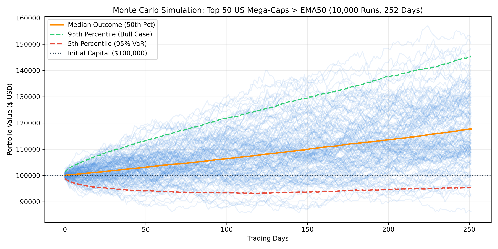

# us-portfolio-monte-carlo
# US Mega-Cap Momentum Monte Carlo Risk Simulator

A quantitative portfolio risk engine in Python that dynamically screens the **Top 50 US Mega-Cap stocks trading above their 50-day Exponential Moving Average (`Price > EMA50`)** via TradingView, pulls historical pricing via `yfinance`, and simulates **10,000 correlated 1-year portfolio paths** using Geometric Brownian Motion (GBM) and Cholesky Decomposition.



---

## Key Features
* **Live Momentum & Mega-Cap Screening:** Queries TradingView's screener API at runtime to filter NYSE/NASDAQ primary stocks where `Close > EMA50`, ranked by market capitalization.
* **Correlation-Preserving Simulation:** Applies **Cholesky Decomposition** ($L L^T = \Sigma$) to the asset covariance matrix so simulated daily shocks reflect real-world sector correlations rather than independent random walks.
* **Institutional Risk Metrics:** Computes **1-Year Median Outcome**, **Probability of Loss**, **95% Value at Risk (VaR)**, and **95% Conditional VaR (Expected Shortfall / CVaR)**.
* **Self-Healing Data Cache:** Automatically saves a local `fallback_prices.csv` snapshot so the simulation runs reliably even offline or under API rate limits.

---

## Quantitative Methodology

1. **Log Returns & Drift:**
   Daily log returns are calculated from adjusted closing prices ($S_t$):
   $$r_t = \ln\left(\frac{S_t}{S_{t-1}}\right)$$

2. **Cholesky Decomposition:**
   To simulate correlated shocks across 50 assets, the regularized covariance matrix $\Sigma$ is decomposed into a lower triangular matrix $L$:
   $$\Sigma = L L^T$$
   Given uncorrelated standard normal random draws $Z \sim \mathcal{N}(0, 1)$, correlated shocks are generated via $\epsilon = Z L^T$.

3. **Geometric Brownian Motion (GBM):**
   Each asset path evolves over $T = 252$ trading days using:
   $$S_{t} = S_{t-1} \exp\left(\left(\mu - \frac{1}{2}\sigma^2\right)\Delta t + \epsilon_t \sqrt{\Delta t}\right)$$

---

## Quick Start

### 1. Clone the repository
```bash
git clone https://github.com
cd YOUR-REPO-NAME
```

### 2. Install dependencies
```bash
pip install -r requirements.txt
```

### 3. Run the simulation
```bash
python simulation.py
```
Running the script will print the 1-year VaR/CVaR risk report to your terminal and refresh `monte_carlo_chart.png` and `fallback_prices.csv`.

---

## Disclaimer
*This project is for educational and quantitative research purposes only and does not constitute financial or investment advice.*

